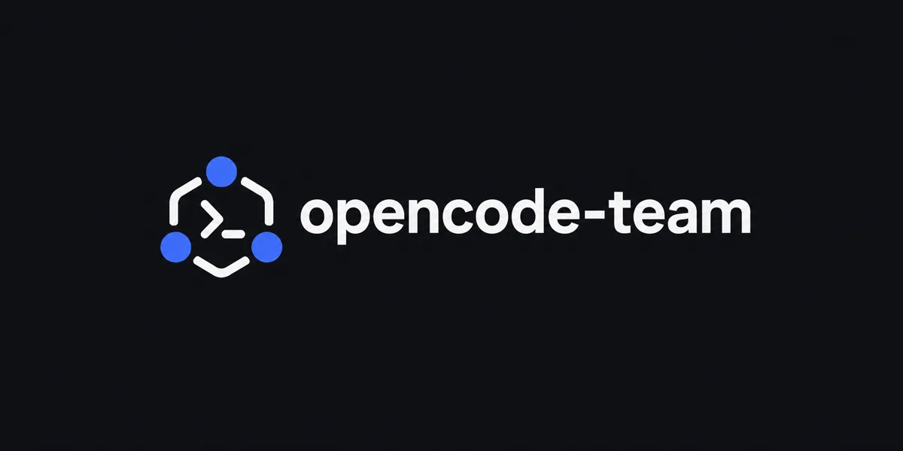
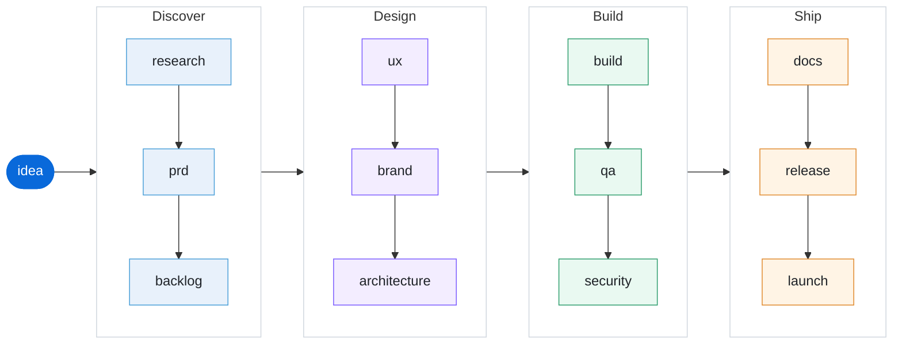

<p align="center">
  
</p>

<h1 align="center">OpenCode Team</h1>

A team of AI agents that takes an idea from research to launch — built on [opencode](https://opencode.ai), with no framework and no extra dependencies.

<p align="center">
  <em>Turkish: <a href="./README.tr.md">README.tr.md</a></em>
</p>



<sub>Each arrow is a gate: the next stage starts after your approval.</sub>

## What it is

OpenCode Team is a **software team** you install once and use in every project. It defines:

- **14 agent roles** — analyst, pm, po, ux, brand, architect, fe, be, qa, devops, security, marketing, docs, and an orchestrator that routes work between them
- **12 pipeline stages** — configured in `team.yaml`, not hardcoded, so you can add, remove, or reorder stages freely
- **12 skills** — one methodology per stage, all local under `skills/team-*`; no external skill is cloned or required
- **17 slash commands** — run a single stage directly, or drive the whole pipeline

The orchestrator is the **default agent**. Open `opencode` anywhere, describe an idea, and the team takes it stage by stage, asking for your approval at each gate.

## Install

Requires OpenCode 1.x (tested on 1.19.0). OpenCode 2 support is planned as a separate release. There is no tagged release yet; `main` is the development branch.

```bash
git clone https://github.com/sametcelikbicak/opencode-team.git
cd opencode-team
./install.sh
```

If OpenCode is not on your PATH, install it first, or let the installer run the official OpenCode 1.x installer:

```bash
./install.sh --install-opencode
```

`--install-opencode` runs `curl -fsSL https://opencode.ai/install | bash`. OpenCode 1 and 2 cannot coexist: an existing OpenCode 2 binary is replaced. Without the flag, the installer never installs OpenCode and leaves an existing binary untouched.

Restart opencode. That's it — the setup is global, so it works in every project directory.

`install.sh` symlinks the repo into your opencode config:

| Path                                | Target                         |
| ----------------------------------- | ------------------------------ |
| `~/.config/opencode/agents`         | `opencode-team/agents`         |
| `~/.config/opencode/commands`       | `opencode-team/commands`       |
| `~/.config/opencode/skills/team-*`  | `opencode-team/skills/team-*`  |
| `~/.config/opencode/team.yaml`      | `opencode-team/team.yaml`      |
| `~/.config/opencode/team/AGENTS.md` | `opencode-team/team/AGENTS.md` |

The repo stays in git; the config directory holds symlinks. Edit a file in the repo and it takes effect immediately.

The installer never modifies `opencode.json`. If `default_agent` is not set to `orchestrator`, it prints the recommended snippet and leaves the file alone.

Check or remove the install:

```bash
./install.sh --check
./install.sh --uninstall
```

`--check` exits non-zero when a symlink is missing. A missing `default_agent` setting is shown as a hint, not a failure. `--uninstall` removes only symlinks that point into this repo.

### Manual setup

If you prefer to wire it yourself, add to `~/.config/opencode/opencode.json`:

```json
{
  "$schema": "https://opencode.ai/config.json",
  "default_agent": "orchestrator",
  "instructions": [
    "~/.config/opencode/team/AGENTS.md",
    "~/.config/opencode/team.yaml"
  ]
}
```

and place the agent, command and skill files in the matching directories.

## Usage

Open opencode in any project and describe what you want:

```bash
cd ~/projects/my-new-app
opencode
```

```
> Build a freelancer invoice reminder app that sends email nudges before and after due dates.
```

The orchestrator reads `team.yaml`, picks a profile, and walks the stages. At every gate it shows you what was produced and waits for approval.

### Running a single stage

Every role has a command. Skip the pipeline and go straight to what you need:

| Command         | Role         | What it does                                |
| --------------- | ------------ | ------------------------------------------- |
| `/research`     | analyst      | Market and competitor research              |
| `/prd`          | pm           | Product requirements document               |
| `/backlog`      | po           | Epics and user stories                      |
| `/ux`           | ux           | Screen flows, states, accessibility         |
| `/brand`        | brand        | Logo, palette, favicon set, brand guide     |
| `/architecture` | architect    | Data model, API contract, module boundaries |
| `/build`        | orchestrator | Frontend + backend implementation           |
| `/qa`           | qa           | Tests from acceptance criteria, run them    |
| `/security`     | security     | Security review                             |
| `/docs`         | docs         | README, API docs, changelog                 |
| `/release`      | devops       | Version, CHANGELOG, deploy, rollback plan   |
| `/launch`       | marketing    | Positioning, copy, channels, metrics        |

Pipeline control:

| Command         | What it does                                             |
| --------------- | -------------------------------------------------------- |
| `/team`         | Start or continue the pipeline                           |
| `/team-status`  | Which stages are done, what's next, where you're blocked |
| `/team-next`    | Run the next stage                                       |
| `/team-approve` | Approve the current gate and continue                    |
| `/role`         | List the team and which stage each role owns             |

## The team

| Role         | Agent file               | Model                               | Writes                     |
| ------------ | ------------------------ | ----------------------------------- | -------------------------- |
| Orchestrator | `agents/orchestrator.md` | `opencode/deepseek-v4.1-flash-free` | — (routes work)            |
| Analyst      | `agents/analyst.md`      | `opencode/beam-free`                | `.team/01-research.md`     |
| PM           | `agents/pm.md`           | `opencode/beam-free`                | `.team/02-prd.md`          |
| PO           | `agents/po.md`           | `opencode/beam-free`                | `.team/03-backlog.md`      |
| UX Designer  | `agents/ux.md`           | `opencode/beam-free`                | `.team/04-ux.md`           |
| Brand        | `agents/brand.md`        | `opencode/deepseek-v4.1-flash-free` | `.team/05-brand.md`        |
| Architect    | `agents/architect.md`    | `opencode/deepseek-v4.1-flash-free` | `.team/06-architecture.md` |
| Frontend     | `agents/fe.md`           | `opencode/deepseek-v4.1-flash-free` | `.team/07-build.md`        |
| Backend      | `agents/be.md`           | `opencode/deepseek-v4.1-flash-free` | `.team/07-build.md`        |
| QA           | `agents/qa.md`           | `opencode/deepseek-v4.1-flash-free` | `.team/08-qa.md`           |
| Security     | `agents/security.md`     | `opencode/deepseek-v4.1-flash-free` | `.team/09-security.md`     |
| Docs         | `agents/docs.md`         | `opencode/deepseek-v4.1-flash-free` | `.team/10-docs.md`         |
| DevOps       | `agents/devops.md`       | `opencode/deepseek-v4.1-flash-free` | `.team/11-release.md`      |
| Marketing    | `agents/marketing.md`    | `opencode/nemotron-3-ultra-free`    | `.team/12-launch.md`       |

All agents are `mode: all`, so each one is reachable three ways: **Tab / Shift+Tab** to cycle, **`@agent-name`** to mention, and the orchestrator can launch it as a subagent via the `task` tool.

Models are free-tier OpenCode Zen models. The defaults were picked by benchmarking: `deepseek-v4.1-flash-free` was the only model that produced fully working code in the test suite (9.5–10.5/10, supports image input), `beam-free` is fast and text-only, `nemotron-3-ultra-free` writes the best Turkish copy. Override any of them in the agent file.

## Output convention

Every stage writes a markdown artifact:

```
.team/
  01-research.md
  02-prd.md
  03-backlog.md
  04-ux.md
  05-brand.md
  06-architecture.md
  07-build.md
  08-qa.md
  09-security.md
  10-docs.md
  11-release.md
  12-launch.md
```

Plain files in a folder. No database, no framework, fully diffable in git, and a human can step in at any stage.

## Design notes

- [Project-local agent memory](./docs/rfcs/0001-project-memory.md) — accepted RFC for a small `.team/memory/` shared by the orchestrator and every specialist agent.

## Customising the pipeline

`team.yaml` is configuration, not code. Change it and the pipeline changes — no code changes needed.

```yaml
profiles:
  new: # starting from scratch
    - research
    - prd
    - backlog
    - ux
    - brand
    - architecture
    - build
    - qa
    - security
    - docs
    - release
    - launch
  change: # working on an existing product
    - research
    - prd
    - architecture
    - build
    - qa

stages:
  - id: research
    title: Market and user research
    agent: analyst
    skill: team-market-research
    gate: true # false = don't wait for approval
    output: .team/01-research.md
    brief: >
      Research the market context, competitors, target user and niche.
      Cite sources, do not guess. End with a decision table.
```

**Project-specific override:** drop a `team.yaml` in your project root and it takes precedence over the global one. That is how you run the same team differently on an existing codebase than on a new idea.

To add a stage: append it to `stages` and to the profile list. To skip approvals: set `gate: false`.

### Adding a role

1. Create `agents/<role>.md` with frontmatter (`name`, `description`, `mode: all`, `model`, `permission`).
2. Reference it in `team.yaml` as `agent: <role>`.
3. Add a command in `commands/<role>.md` if you want a direct entry point.

## Language

The team's working language follows you. Agent instructions, code, code comments and technical documentation are in English; everything else — PRDs, research, UX rationale, marketing copy — is written in whichever language you are using. Ask for a specific language per artifact any time and it will be honoured.

## Requirements

- [opencode](https://opencode.ai) 1.x (tested on 1.19.0)
- An OpenCode Zen account or any provider configured in opencode — the defaults use free-tier models

## Disclaimer

OpenCode Team is a community-driven project and is **not** built by, affiliated with, or endorsed by OpenCode (opencode.ai) or anomalyco/opencode. "OpenCode" is a trademark of Anomaly. This project uses the OpenCode CLI as its underlying agent framework.

## Third-party notices

The team skills are local. `team-build`, `team-backlog` and `team-brand` are adapted from MIT-licensed upstream skills; see [THIRD_PARTY_NOTICES.md](./THIRD_PARTY_NOTICES.md) for attribution and licence text.

## License

MIT. See [LICENSE](./LICENSE).
