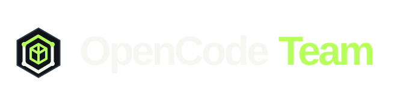

<p align="center">
  
</p>

<p align="center">
  <a href="https://github.com/sametcelikbicak/opencode-team/actions/workflows/checks.yml"></a>
  <a href="https://github.com/sametcelikbicak/opencode-team/actions/workflows/docs.yml"></a>
  <a href="https://www.npmjs.com/package/@opencodeteam/cli"></a>
  <a href="https://www.npmjs.com/package/@opencodeteam/cli"></a>
  <a href="https://img.shields.io/node/v/@opencodeteam/cli?logo=nodedotjs&label=&logoColor=white&color=339933"></a>
  <a href="LICENSE"></a>
  <a href="https://github.com/sametcelikbicak/opencode-team/stargazers"></a>
  <a href="CHANGELOG.md"></a>
  <a href="SUPPORT.md"></a>
  <a href="CODE_OF_CONDUCT.md"></a>
  <a href="https://opencode.ai"></a>
</p>

A team of AI agents that takes an idea from research to launch — built on [opencode](https://opencode.ai), with no framework and no extra dependencies.

<p align="center">
  
</p>

<sub>Each arrow is a gate: the next stage starts after your approval.</sub>

## What it is

OpenCode Team is a **software team** you install once and use in every project. It defines:

- **14 agent roles** — analyst, pm, po, ux, brand, architect, fe, be, qa, devops, security, marketing, docs, and an orchestrator that routes work between them
- **12 pipeline stages** — configured in `team.yaml`, not hardcoded, so you can add, remove, or reorder stages freely
- **14 skills** — 12 stage methodologies plus `team-memory` and `team-discipline`, all local under `skills/team-*`; no external skill is cloned or required
- **19 slash commands** — run a single stage directly, or drive the whole pipeline

The orchestrator is the **default agent**. Open `opencode` anywhere, describe an idea, and the team takes it stage by stage, asking for your approval at each gate.

## Install

Requires OpenCode 2.x (tested on 2.2.5). This release targets OpenCode 2.x only. OpenCode 1 and 2 cannot coexist; OpenCode 1.x users: use Release v1.0.0 (@opencodeteam/cli@1.0.0).

Supported on macOS, Linux, and native Windows (Windows PowerShell 5.1 or PowerShell 7; verified with OpenCode 2.2.5). WSL is untested.

Full install instructions — both install methods, copy vs symlink, verify/uninstall/update, and Windows steps: [docs/install.md](./docs/install.md).

Quick reference:

| Path                                | Target                         |
| ----------------------------------- | ------------------------------ |
| `~/.config/opencode/agents`         | `opencode-team/agents`         |
| `~/.config/opencode/commands`       | `opencode-team/commands`       |
| `~/.config/opencode/skills/team-*`  | `opencode-team/skills/team-*`  |
| `~/.config/opencode/team.yaml`      | `opencode-team/team.yaml`      |
| `~/.config/opencode/team/AGENTS.md` | `opencode-team/team/AGENTS.md` |

The repo stays in git; the config directory holds symlinks. Edit a file in the repo and it takes effect immediately.

Neither installer modifies `opencode.json`. If `default_agent` is not set to `orchestrator`, it prints the recommended snippet and leaves the file alone. On Windows the default directory is `%USERPROFILE%\.config\opencode`; both installers honor `OPENCODE_CONFIG_DIR`.

## Usage

Open opencode in any project and describe what you want:

```bash
cd ~/projects/my-new-app
opencode
```

Full usage guide, single-stage commands and pipeline control: [docs/usage.md](./docs/usage.md).

## The team

14 agent roles, each owning a pipeline stage and writing a `.team/` artifact. Full role → agent file → artifact mapping: [docs/reference/agents.md](./docs/reference/agents.md).

All agents are `mode: all`, reachable three ways: **`@agent-name`** to mention, **Shift+Tab** (or `/agents`) to switch, and the orchestrator can launch one as a subagent via the `subagent` tool.

No agent pins a model: each one runs on the session's active model, so any provider configured in OpenCode works. To pin a model for a single agent, add a `model:` field to its frontmatter — the filename supplies the agent id, so no `name:` field is needed:

```yaml
---
description: "Marketing: positioning, copywriting, launch strategy, go-to-market"
model: opencode/nemotron-3-ultra-free
---
```

Free-tier OpenCode Zen picks used while testing: `deepseek-v4.1-flash-free` (code, image input), `beam-free` (fast, text-only), `nemotron-3-ultra-free` (Turkish copy).

## Output convention

Every stage writes a numbered markdown artifact in `.team/` (01-research.md … 12-launch.md). The build stage also writes intermediate `07-build-fe.md` and `07-build-be.md`, consolidated into `07-build.md`.

Full `.team/`, memory and runs directory trees: [docs/output.md](./docs/output.md).

## Memory

OpenCode Team keeps a small, project-local memory in `.team/memory/` so the orchestrator and specialist agents have continuity across sessions.

Full protocol — what each agent does, commands (`/memory`, `/remember`), and rules: [docs/memory.md](./docs/memory.md).

## Run checkpoints

The orchestrator records each run and task attempt in `.team/runs/` so a compaction or restart does not repeat completed work or skip unfinished work.

Full protocol — `run.json`, `events/`, `approvals/`, and how the orchestrator reconciles attempts at session start: [docs/runs.md](./docs/runs.md).

## Customising the pipeline

`team.yaml` is configuration, not code. Change it and the pipeline changes — no code changes needed.

Full reference — profiles, stage fields, adding a stage, adding a role: [docs/customization.md](./docs/customization.md).

## Language

The team's working language follows you. Agent instructions, code, code comments and technical documentation are in English; everything else — PRDs, research, UX rationale, marketing copy — is written in whichever language you are using. Ask for a specific language per artifact any time and it will be honoured.

## Requirements

- [opencode](https://opencode.ai) 2.x (tested on 2.2.5)
- Any provider configured in OpenCode — OpenCode Zen or your own. Agents inherit the session's active model.

## Disclaimer

OpenCode Team is a community-driven project and is **not** built by, affiliated with, or endorsed by OpenCode (opencode.ai) or anomalyco/opencode. "OpenCode" is a trademark of Anomaly. This project uses the OpenCode CLI as its underlying agent framework.

## Third-party notices

The team skills are local. `team-build`, `team-backlog`, `team-brand` and `team-discipline` are adapted from MIT-licensed upstream skills; see [THIRD_PARTY_NOTICES.md](./THIRD_PARTY_NOTICES.md) for attribution and licence text.

---

## Contributors

Contributions are welcome! See [CONTRIBUTING.md](./CONTRIBUTING.md) for guidelines.

<a href="https://github.com/sametcelikbicak/opencode-team/graphs/contributors">
  
</a>

---

⭐ If OpenCode Team makes your AI agent workflow easier, consider [starring the repo](https://github.com/sametcelikbicak/opencode-team/stargazers).
It helps others discover the project and shows that the community finds it useful.

## License

MIT. See [LICENSE](./LICENSE).
