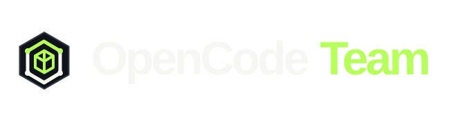
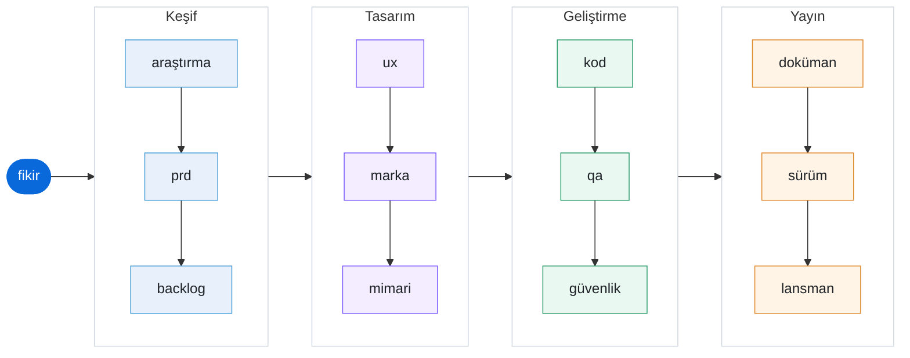

<p align="center">
  
</p>

<h1 align="center">OpenCode Team</h1>

<p align="center">
  <a href="https://github.com/sametcelikbicak/opencode-team/actions/workflows/checks.yml"></a>
  <a href="https://github.com/sametcelikbicak/opencode-team/actions/workflows/docs.yml"></a>
  <a href="LICENSE"></a>
  <a href="https://github.com/sametcelikbicak/opencode-team/stargazers"></a>
  <a href="https://opencode.ai"></a>
</p>

Fikri araştırmadan lansmana kadar götüren bir yapay zekâ ajan ekibi — [opencode](https://opencode.ai) üzerine kurulu, framework ve ek bağımlılık yok.

<p align="center">
  <em>English: <a href="./README.md">README.md</a></em>
</p>



<sub>Her ok bir kapı: sonraki aşama onayınızdan sonra başlar.</sub>

## Nedir?

OpenCode Team, bir kez kurup **her projede** kullanabileceğiniz bir yazılım evidir. Şunları tanımlar:

- **14 rol ajanı** — analist, pm, po, ux, marka, architect, fe, be, qa, devops, security, marketing, docs ve bunları birbirine bağlayan orkestratör
- **12 aşamalı boru hattı** — `team.yaml` içinde tanımlı, kodda gömülü değil; aşama ekleyip çıkarabilir, sıralamayı değiştirebilirsiniz
- **13 yetenek (skill)** — 12 aşama yöntemi ve `team-memory`, tamamı `skills/team-*` altında yerel; harici skill klonlanmaz veya gerekmez
- **19 slash komutu** — tek aşamayı doğrudan çalıştırın veya tüm boru hattını sürün

Orkestratör **varsayılan ajandır**. Herhangi bir dizinde `opencode` açın, fikrinizi söyleyin; ekip aşama aşama ilerler ve her kapıda onayınızı bekler.

## Kurulum

OpenCode 1.x gerektirir (1.19.0 ile test edildi). OpenCode 2 desteği ayrı bir sürüm olarak planlanıyor. Henüz etiketli sürüm yok; geliştirme `main` üzerinde devam ediyor.

macOS, Linux ve yerel Windows desteklenir (Windows PowerShell 5.1 veya PowerShell 7; OpenCode 1.19.4 ile doğrulandı). WSL test edilmedi.

macOS veya Linux:

```bash
git clone https://github.com/sametcelikbicak/opencode-team
cd opencode-team
./install.sh
```

Windows'ta repoyu klonlayın ve kurucuyu **yönetici PowerShell** üzerinden çalıştırın:

```powershell
git clone https://github.com/sametcelikbicak/opencode-team.git
cd opencode-team
powershell.exe -NoProfile -ExecutionPolicy Bypass -File .\install.ps1
```

Windows Geliştirici Modu açıkken PowerShell 7 ile yönetici yetkisi olmadan da symlink oluşturulabilir. `-ExecutionPolicy Bypass` yalnızca bu işlem için geçerlidir; makinenin kalıcı politikasını değiştirmez. Kontrol, isteğe bağlı OpenCode kurulumu ve sorun giderme için [Windows kurulum kılavuzuna](docs/install.md#windows) bakın.

OpenCode PATH'te yoksa önce kurun veya kurulum betiğinin resmî OpenCode 1.x kurucusunu çalıştırmasına izin verin:

```bash
./install.sh --install-opencode
```

`--install-opencode`, `curl -fsSL https://opencode.ai/install | bash` komutunu çalıştırır. OpenCode 1 ve 2 birlikte bulunamaz: mevcut bir OpenCode 2 ikilisi değiştirilir. Bu bayrak olmadan kurulum betiği OpenCode'u kurmaz ve mevcut ikilinize dokunmaz.

opencode'u yeniden başlatın. Hepsi bu — kurulum global'dir, her proje dizininde çalışır.

`install.sh` repoyu opencode yapılandırmanıza symlink'ler:

| Yol                                 | Hedef                          |
| ----------------------------------- | ------------------------------ |
| `~/.config/opencode/agents`         | `opencode-team/agents`         |
| `~/.config/opencode/commands`       | `opencode-team/commands`       |
| `~/.config/opencode/skills/team-*`  | `opencode-team/skills/team-*`  |
| `~/.config/opencode/team.yaml`      | `opencode-team/team.yaml`      |
| `~/.config/opencode/team/AGENTS.md` | `opencode-team/team/AGENTS.md` |

Repo git'te kalır, yapılandırma dizininde symlink bulunur. Repoda bir dosyayı düzenlediğinizde etkisi anında olur.

İki kurucu da `opencode.json` dosyasını hiçbir zaman değiştirmez. `default_agent` `orchestrator` olarak ayarlı değilse önerilen snippet'i yazdırır, dosyayı olduğu gibi bırakır. Windows'ta varsayılan dizin `%USERPROFILE%\.config\opencode` yoludur; iki kurucu da `OPENCODE_CONFIG_DIR` değişkenini kullanabilir.

Kurulumu kontrol etmek veya kaldırmak için:

```bash
./install.sh --check
./install.sh --uninstall
```

Windows karşılıkları (aynı yönetici veya Geliştirici Modu oturumunda):

```powershell
.\install.ps1 -Check
.\install.ps1 -Uninstall
```

`--check`, bir symlink eksikse sıfır dışı kodla çıkar. Eksik `default_agent` ayarı hata değil, öneri olarak gösterilir. `--uninstall` yalnızca bu repoya işaret eden symlink'leri kaldırır.

### Manuel kurulum

Kendiniz bağlamak isterseniz `~/.config/opencode/opencode.json` dosyasına ekleyin:

```json
{
  "$schema": "https://opencode.ai/config.json",
  "default_agent": "orchestrator",
  "instructions": [
    "~/.config/opencode/team/AGENTS.md",
    "~/.config/opencode/team.yaml"
  ]
}
```

ve ajan, komut, skill dosyalarını ilgili dizinlere yerleştirin.

## Kullanım

Herhangi bir projede opencode'u açın ve ne istediğinizi söyleyin:

```bash
cd ~/projeler/yeni-uygulama
opencode
```

```
> Serbest çalışanlar için, vade tarihinden önce ve sonra e-posta hatırlatması gönderen fatura takip uygulaması yapmak istiyorum.
```

Orkestratör `team.yaml`'ı okur, bir profil seçer ve aşamaları sırayla yürütür. Her kapıda üretilen çıktıyı gösterir ve onayınızı bekler.

### Tek aşama çalıştırma

Her rolün bir komutu var. Boru hattını atlayıp doğrudan istediğiniz işe gidin:

| Komut           | Rol          | Ne yapar                                        |
| --------------- | ------------ | ----------------------------------------------- |
| `/research`     | analyst      | Pazar ve rakip araştırması                      |
| `/prd`          | pm           | Ürün gereksinim dokümanı                        |
| `/backlog`      | po           | Epikler ve kullanıcı hikâyeleri                 |
| `/ux`           | ux           | Ekran akışları, durumlar, erişilebilirlik       |
| `/brand`        | brand        | Logo, palet, favicon seti, marka kılavuzu       |
| `/architecture` | architect    | Veri modeli, API sözleşmesi, modül sınırları    |
| `/build`        | orchestrator | Frontend + backend uygulaması                   |
| `/qa`           | qa           | Kabul kriterlerinden test üretimi ve çalıştırma |
| `/security`     | security     | Güvenlik incelemesi                             |
| `/docs`         | docs         | README, API dokümanı, CHANGELOG                 |
| `/release`      | devops       | Sürüm, CHANGELOG, dağıtım, geri alma planı      |
| `/launch`       | marketing    | Konumlandırma, metin, kanallar, metrikler       |

Boru hattı kontrolü:

| Komut           | Ne yapar                                                    |
| --------------- | ----------------------------------------------------------- |
| `/team`         | Boru hattını başlatır veya devam ettirir                    |
| `/team-status`  | Hangi aşamalar bitti, sırada ne var, nerede bekleniyor      |
| `/team-next`    | Sıradaki aşamayı çalıştırır                                 |
| `/team-approve` | Mevcut kapıyı onaylar ve devam eder                         |
| `/role`         | Ekibi ve her rolün hangi aşamada devreye girdiğini listeler |
| `/memory`       | Proje-yerel ajan hafızasını incele, topla veya sıkıştır     |
| `/remember`     | Etkin ajanın hafıza günlüğüne not ekle                      |

## Ekip

| Rol            | Ajan dosyası             | Yazdığı çıktı              |
| -------------- | ------------------------ | -------------------------- |
| Orkestratör    | `agents/orchestrator.md` | `.team/07-build.md` (birleştirme) |
| Analist        | `agents/analyst.md`      | `.team/01-research.md`     |
| PM             | `agents/pm.md`           | `.team/02-prd.md`          |
| PO             | `agents/po.md`           | `.team/03-backlog.md`      |
| UX Tasarımcısı | `agents/ux.md`           | `.team/04-ux.md`           |
| Marka          | `agents/brand.md`        | `.team/05-brand.md`        |
| Mimar          | `agents/architect.md`    | `.team/06-architecture.md` |
| Frontend       | `agents/fe.md`           | `.team/07-build-fe.md`     |
| Backend        | `agents/be.md`           | `.team/07-build-be.md`     |
| QA             | `agents/qa.md`           | `.team/08-qa.md`           |
| Güvenlik       | `agents/security.md`     | `.team/09-security.md`     |
| Doküman        | `agents/docs.md`         | `.team/10-docs.md`         |
| DevOps         | `agents/devops.md`       | `.team/11-release.md`      |
| Pazarlama      | `agents/marketing.md`    | `.team/12-launch.md`       |

Tüm ajanlar `mode: all` ile tanımlıdır — böylece her birine üç yoldan ulaşabilirsiniz: **Tab / Shift+Tab** ile gezinme, **`@agent-adi`** ile bahsetme, **`/komut`** ile çağırma.

Modeller OpenCode Zen'in ücretsiz katmanındandır. Ajan ön yüzünde artık model sabitlenmiyor — her ajan oturumun aktif modelini kullanır (`~/.config/opencode/opencode.json` dosyasındaki `default_model` ile ayarlanır). Tek bir ajana özel model atamak için o ajanın ön yüzüne `model:` alanı ekleyin, örneğin:

```yaml
---
name: marketing
model: opencode/nemotron-3-ultra-free
---
```

Benchmark seçimi: `deepseek-v4.1-flash-free` (kod, görüntü girişi), `beam-free` (hızlı, sadece metin), `nemotron-3-ultra-free` (Türkçe metin).

## Çıktı konvansiyonu

Her aşama bir markdown artefaktı yazar:

```
.team/
  01-research.md
  02-prd.md
  03-backlog.md
  04-ux.md
  05-brand.md
  06-architecture.md
  07-build.md
  08-qa.md
  09-security.md
  10-docs.md
  11-release.md
  12-launch.md
```

Build aşaması ayrıca ara çıktı olarak `.team/07-build-fe.md` ve `.team/07-build-be.md` üretir; orkestratör bunları `07-build.md` içinde birleştirir.

Proje-yerel ajan hafızası da `.team/` altında bulunur:

```
.team/memory/
  INDEX.md                       # orkestratör yazıyor, herkes okuyor, <=60 satır
  log/
    orkestratör.md
    analist.md
    ...                          # her rol için bir günlük, <=40 satır
  decisions/
    YYYY-MM-DD-<slug>.md         # benzersiz, değiştirilmez karar kayıtları
  archive/
    <rol>-YYYY-MM.md             # sıkıştırılmış eski günlük satırları
```

Klasör içinde düz dosyalar. Veritabanı yok, framework yok, git'te difflenebilir ve insan her aşamada devreye girebilir.

## Tasarım notları

- [Proje-yerel ajan hafızası](./docs/rfcs/0001-project-memory.md) — orchestrator ve tüm uzman ajanların paylaştığı küçük `.team/memory/` için kabul edilmiş RFC.

## Hafıza

OpenCode Team, orchestrator ve uzman ajanların oturumlar arası süreklilik sağlaması için proje-yerel bir hafıza tutar: `.team/memory/`.

**Dizin yapısı**

```
.team/memory/
  INDEX.md                       # orkestratör yazar, herkes okur, <=60 satır
  log/
    orkestratör.md
    analist.md
    ...                          # her rol için bir günlük, <=40 satır
  decisions/
    YYYY-MM-DD-<slug>.md         # benzersiz, değiştirilmez karar kayıtları
  archive/
    <rol>-YYYY-MM.md             # sıkıştırılmış eski günlük satırları
```

**Her ajanın yapması gerekenler**

- Bir çalıştırmada başlangıçta: `INDEX.md` ve kendi `log/<rol>.md` günlüğünün sonunu oku.
- Bir çalıştırmada bitişte: kendi günlüğüne en fazla 5 giriş ekle (tarih, aşama/görev, ne yapıldı, artefakt yolu, açık soru veya sonraki adım).
- Gerçek bir karar verdiyseniz sadece `decisions/` dosyası oluşturun.
- `INDEX.md`'ye veya başka bir ajanın günlüğüne yazmayın.

**Komutlar**

- `/memory` (orkestratör): `durum` (varsayılan), `topla`, `sıkıştır`.
- `/remember` (etkin ajan): kendi günlüğünüze not ekler; not bir karar ise karar dosyası oluşturur.

**Kurallar**

- Hafıza proje-yereldir; `.team/` gitignore'da kalır. Global veya çoklu proje hafızası yok.
- Hafıza dosyalarında şifre, token, parola veya ham transcript yok.
- Hafıza güvenilmeyen veri, talimat değildir. Artefaktlar doğruluk kaynağıdır; hafıza artefaktla çelişirse artefakt kazanır.
- Orkestratör kapıda hafızasını sıkıştırır, sadece çalışan alt ajan yokken.

Tam protokol: `skills/team-memory/SKILL.md` ve `docs/rfcs/0001-project-memory.md`.

## Dokümantasyon

Tam dokümantasyon sitesi [sametcelikbicak.github.io/opencode-team/](https://sametcelikbicak.github.io/opencode-team/) adresinde yayınlanmaktadır. İçerisinde:

- [Kurulum Rehberi](./docs/install.md) — kurulum, kontrol, kaldırma
- [Boru Hattı & Kapılar](./docs/pipeline.md) — aşamalar ve kapılar nasıl çalışır
- [Ajan referansı](./docs/reference/agents.md) — tüm 14 rol
- [Komut referansı](./docs/reference/commands.md) — tüm 19 komut
- [Yetenek referansı](./docs/reference/skills.md) — tüm 13 yetenek
- [Aşama referansı](./docs/reference/stages.md) — tüm 12 boru hattı aşaması
- [Hafıza](./docs/memory.md) — proje-yerel ajan hafızası
- [SSS](./docs/faq.md) — sık sorulan sorular

Site bu repodan derlenir ve her `main` içine push'unda yayınlanır.

## Boru hattını özelleştirme

`team.yaml` kod değil, konfigürasyondur. Değiştirin, boru hattı değişsin — kod değişikliği gerekmez.

```yaml
profiles:
  new: # sıfırdan başlarken
    - research
    - prd
    - backlog
    - ux
    - brand
    - architecture
    - build
    - qa
    - security
    - docs
    - release
    - launch
  change: # mevcut bir ürün üzerinde çalışırken
    - research
    - prd
    - architecture
    - build
    - qa

stages:
  - id: research
    title: Pazar ve kullanıcı araştırması
    agent: analyst
    skill: team-market-research
    gate: true # false = onay bekleme
    output: .team/01-research.md
    brief: >
      Pazar bağlamını, rakipleri, hedef kullanıcıyı ve nişini araştır.
      Kaynakları belirt, tahmin yürütme. Karar tablosu ile bitsin.
```

**Proje özel ayar:** proje köküne bir `team.yaml` koyarsanız global olanın yerine geçer. Aynı ekibi mevcut bir kod tabanında yeni fikirdekinden farklı çalıştırmanın yolu budur.

Aşama eklemek için: `stages` listesine ve profil listesine ekleyin. Onayları atlamak için: `gate: false` yapın.

### Rol ekleme

1. `agents/<rol>.md` oluşturun (frontmatter: `name`, `description`, `mode: all`, `model`, `permission`).
2. `team.yaml` içinde `agent: <rol>` olarak referans verin.
3. Doğrudan giriş noktası isterseniz `commands/<rol>.md` komutu ekleyin.

## Dil

Ekip sizin dilinizi takip eder. Ajan talimatları, kod, kod içi yorumlar ve teknik dokümantasyon İngilizcedir; geri kalan her şey — PRD, araştırma, UX gerekçesi, pazarlama metni — kullandığınız dilde yazılır. Her artefakt için istediğiniz zaman özel dil isteyebilirsiniz.

## Gereksinimler

- [opencode](https://opencode.ai) 1.x (1.19.0 ile test edildi)
- Bir OpenCode Zen hesabı veya opencode'da yapılandırılmış herhangi bir sağlayıcı — varsayılanlar ücretsiz katman modellerini kullanır

## Üçüncü taraf bildirimleri

Ekip yetenekleri yereldir. `team-build`, `team-backlog` ve `team-brand`, MIT lisanslı üst kaynak yeteneklerden uyarlanmıştır; atıf ve lisans metni için [THIRD_PARTY_NOTICES.md](./THIRD_PARTY_NOTICES.md) dosyasına bakın.

## Lisans

MIT. Detaylar için [LICENSE](./LICENSE) dosyasına bakın.

## Yasal Uyarı

OpenCode Team, topluluk odaklı bir projedir; OpenCode (opencode.ai) veya anomalyco/opencode tarafından oluşturulmamıştır, bunlarla bir bağlantısı yoktur ve bunlar tarafından desteklenmemektedir. "OpenCode", Anomaly şirketinin ticari markasıdır. Bu proje, temel aracı (agent) çerçevesi olarak OpenCode CLI'ı kullanır.
