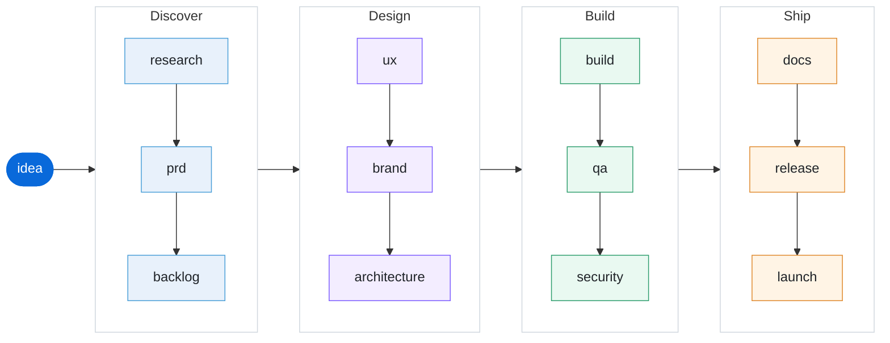

# OpenCode Team

A team of AI agents that takes an idea from research to launch — built on [opencode](https://opencode.ai), with no framework and no extra dependencies.

## What it is

OpenCode Team is a **software team** you install once and use in every project. It defines:

- **14 agent roles** — analyst, pm, po, ux, brand, architect, fe, be, qa, devops, security, marketing, docs, and an orchestrator that routes work between them
- **12 pipeline stages** — configured in `team.yaml`, not hardcoded, so you can add, remove, or reorder stages freely
- **13 skills** — 12 stage methodologies plus `team-memory`, all local under `skills/team-*`; no external skill is cloned or required
- **19 slash commands** — run a single stage directly, or drive the whole pipeline

The orchestrator is the **default agent**. Open `opencode` anywhere, describe an idea, and the team takes it stage by stage, asking for your approval at each gate.

## Pipeline



<sub>Each arrow is a gate: the next stage starts after your approval.</sub>

## Quick Start

```bash
# Clone the repository
git clone https://github.com/sametcelikbicak/opencode-team.git
cd opencode-team

# Install the team into your OpenCode config
./install.sh

# Restart opencode, then describe an idea
opencode
```

## Documentation

- [Installation](./install) — install, check, uninstall
- [Pipeline & Gates](./pipeline) — how stages and gates work
- [Customization](./customization) — add agents, commands, skills
- [Agent reference](./reference/agents) — all 14 roles
- [Command reference](./reference/commands) — all 19 slash commands
- [Skill reference](./reference/skills) — all 13 skills
- [Stage reference](./reference/stages) — all 12 pipeline stages
- [Memory](./memory) — project-local agent memory
- [Run checkpoints](./runs) — resume after compaction or interruption
- [FAQ](./faq) — common questions

## License

MIT. See [LICENSE](https://github.com/sametcelikbicak/opencode-team/blob/main/LICENSE).
